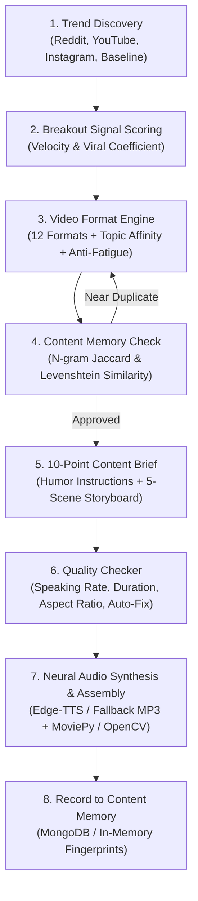

# AI Video Variety Engine — Architecture & Implementation

## 1. Executive Summary

The **AI Video Variety Engine** prevents automated video systems from repeatedly producing monotonous, identical short-form videos. It replaces single-template generation with an evidence-based, multi-format storytelling system that discovers emerging trends, selects among 12 diverse narrative formats, enforces content memory deduplication, generates structured 10-point briefs with comedic character instructions, and validates video assets against strict quality bounds.

---

## 2. End-to-End Workflow Architecture



---

## 3. Core Engine Components

### 3.1 Trend Discovery & Breakout Signal Scoring (`lib/trend/trend-discovery.ts`)
- **Multi-Niche Support**: `fresher_careers`, `humor_roasts`, `salary_reality`.
- **Metrics Evaluated**:
  - Velocity: $\text{views} / \text{hours elapsed}$.
  - Viral Coefficient: $\text{views} / \text{baseline}$.
  - Breakout Signal: Triggered when $\text{velocity} > 1,200 \text{ views/hr}$ or $\text{viralCoef} \ge 3.5$.
- **Evidence Verification**: Every trend carries a confidence score ($\ge 0.80$), verified source URL, and timestamp.
- **Resilience**: Gracefully handles missing metrics, network timeouts, and API rate limits via curated radar signals.

### 3.2 The 12 Storytelling Video Formats (`lib/variety/format-engine.ts`)

| # | Format ID | Format Name | Narration Tone | Story Arc |
|---|---|---|---|---|
| 1 | `mini_documentary` | Mini Documentary | Serious, investigative, deep-dive | Hook $\to$ Context $\to$ Investigation $\to$ Evidence $\to$ Takeaway |
| 2 | `storytelling` | Storytelling (Personal Journey) | Vulnerable, relatable, inspiring | Relatable Struggle $\to$ Low Point $\to$ Turning Point $\to$ Victory $\to$ Moral |
| 3 | `pov` | POV (First-Person Experiential) | Hilarious, self-deprecating, sarcastic | Relatable Scene $\to$ Brutal Friend Roast $\to$ The Twist $\to$ Payoff $\to$ CTA |
| 4 | `myth_vs_fact` | Myth vs Fact | Direct, sharp, confident | Common Myth $\to$ Why Believed $\to$ The Harsh Truth $\to$ Proof $\to$ Real Action |
| 5 | `top_listicle` | Top 3 / Top 5 Countdown | High energy, authoritative curator | Surprising Opener $\to$ Item 3 $\to$ Item 2 $\to$ Item 1 (Best) $\to$ Bookmark CTA |
| 6 | `tutorial` | Tutorial / How-To | Patient, step-by-step mentor | Desired Outcome $\to$ Step 1 $\to$ Step 2 $\to$ Pro Tip $\to$ Challenge |
| 7 | `news_explainer` | News Explainer | Urgent, fast-paced, broadcast journalist | Breaking Headline $\to$ What Happened $\to$ Why It Matters $\to$ Impact $\to$ Verification |
| 8 | `before_vs_after` | Before vs After | Contrastive, dramatic transformation | The Old Way $\to$ The Frustration $\to$ The Pivot $\to$ The New Reality $\to$ Blueprint |
| 9 | `problem_vs_solution` | Problem vs Solution | Empathetic, triumphant, problem-solving | Pain Point $\to$ Why Current Fixes Fail $\to$ New Mechanism $\to$ Proof $\to$ Action Step |
| 10 | `experiment_challenge` | Experiment / Challenge | Curious, adventurous, bold | Wild Hypothesis $\to$ Test Setup $\to$ The Experiment $\to$ Surprising Result $\to$ Verdict |
| 11 | `case_study` | Case Study | Analytical, data-driven, strategic | Surprising Result $\to$ Background $\to$ Core Strategy $\to$ Metric Breakdown $\to$ Playbook |
| 12 | `cinematic_narrative` | Cinematic Narrative | Atmospheric, theatrical, evocative | Cinematic Hook $\to$ Tension $\to$ Climax $\to$ Revelation $\to$ Lingering Thought |

- **Selection Logic**:
  - Matches topic keywords against format affinity rules.
  - Applies a **0.35 anti-fatigue penalty** to recently used formats in consecutive uploads.

---

### 3.3 Multi-Model Comedy & Script Writing Instructions (`lib/variety/script-brief-engine.ts`)

The AI engine includes full instructions for generating comedy scripts across 4 distinct styles:

1. **`friend_roast` (Funny Friend Roast / POV)**:
   - **Dynamic**: Friend roasts protagonist for unemployment or engineering degree ("Bhai 4 saal engineering karke ab chai ki tapri kholega kya?").
   - **Comeback**: Protagonist reveals a verified DinoMate tech opening with zero experience required.
   - **Comic Beats**: Mocking Sharma ji ka beta 99% CGPA myth, college tapri debt, and biryani treat.

2. **`corporate_sarcasm` (Corporate Absurdity)**:
   - **Dynamic**: Roasting job postings that ask freshers for 5 years of Next.js 15 and Kubernetes experience for a 12k internship.
   - **Resolution**: Showing verified 0-experience openings with real starting compensation and direct PPO.

3. **`placement_drama` (Campus Placement Reality)**:
   - **Dynamic**: Campus placement cell promising 40 LPA packages that turn out to be door-to-door sales roles.
   - **Resolution**: Bypassing campus politics to apply directly to verified product startup roles.

4. **`fresher_struggle` (LinkedIn Application Black Hole)**:
   - **Dynamic**: Submitting 500 applications on LinkedIn with 0 replies and 599 automated rejection bots.
   - **Resolution**: Direct HR verified links that avoid bot filtering.

---

### 3.4 Content Memory & Similarity Deduplication (`lib/variety/content-memory.ts`)

- **Topic Similarity**: Token n-gram Jaccard similarity. Rejects candidates if similarity $\ge 0.70$.
- **Hook Similarity**: Levenshtein distance similarity. Rejects candidates if hook text similarity $\ge 0.65$.
- **Format Repetition**: Prevents the same format from running more than 2 consecutive times.
- **Smart Allowance**: Legitimate recurring topics (e.g. Fresher Hiring) are approved when the **angle** and **format** are distinctly different.

---

### 3.5 Quality Validation & Auto-Sanitization (`lib/variety/quality-checks.ts`)

- **Duration Bounds**: Strictly between 15s and 20s (calibrated for high retention viral Reels & Shorts, ~3.0-3.8s per scene).
- **Aspect Ratio**: 9:16 for Reels/Shorts (1080x1920), 1:1 / 4:4 for Carousels (1080x1080).
- **Speaking Rate**: Validated at $2.2$ to $3.4$ words/second ($130-200$ WPM). Scenes are automatically retimed if speech is rushed or dragged.
- **Claim Sanitizer**: Automatically detects and replaces unsubstantiated claims (e.g., replaces `"100% guaranteed job"` with `"top verified opportunity"`).
- **Native SVG Rendering**: Replaces unicode arrow characters (`➔`) with inline vector SVGs to prevent broken font boxes (`[]`) across systems.

---

## 4. Test & Verification Commands

All test suites reside in `/Test` and run with complete offline / sandbox hermetic isolation:

```bash
# 1. Video Variety Engine Full Test Suite (79 assertions)
pnpm run test:variety

# 2. 1080x1920 MP4 Video Synthesis & Synced Audio Test
pnpm run test:video

# 3. 1080x1080 (4x4 Ratio) Image Carousel Generation Test
pnpm run test:image

# 4. DinoMate System & Integration Health Audit
pnpm run test:system
```

---

## 5. Character & Presentation Archetypes

The Variety Engine dynamically chooses between distinct presentation styles so consecutive videos never feel repetitive:

1. **`dino_mascot` (Cartoon DinoMate Dinosaur)**:
   - Features the brand mascot **Dino**—a witty cartoon green dinosaur in vector SVG.
   - Roasts crazy recruiter expectations (*"I was extinct 65 million years ago, even I don't have 10 years React experience!"*).
   - Delivers punchy verified 0-experience job drops with humorous sound cues.
2. **`solo_explainer` (Solo Mentor / Insider)**:
   - A single authoritative tech creator/mentor directly explaining the job opening 1-on-1.
   - Focuses on practical assessment criteria, interview rounds, and roadmap without comedic sketch dialogue.
3. **`funny_roast` (2-Person Comic Banter)**:
   - Relatable Indian college dialogue (*chai tapri roast, Sharma ji ka beta comparison, placement cell scam*).
4. **`cyber_infographic` (High-Tech Motion Graphic)**:
   - Minimalist neon data cards, salary countdowns, and myth-vs-fact contrasts.

---

## 6. How AI Discovers Trending Topics From the Internet

The discovery engine collects signals from authorized, public, real-time sources:
1. **Reddit Indian Tech & Student Communities**:
   - `r/developersIndia` & `r/Btechtards`: Scrapes hot community sentiment, placement memes, and career discussions.
2. **DinoMate Live Job Feed**:
   - Real-time entry-level and fresher job spikes (`dinomate.app/api/public/jobs`).
3. **Hacker News & Tech News Radar**:
   - High-velocity developer discussions with upvote velocity calculation.
4. **Velocity & Breakout Scoring**:
   - Compares view/engagement velocity against baseline averages. A topic is only marked as `isBreakout: true` when velocity exceeds thresholds, eliminating fabricated trends.

---

## 7. Artifacts Produced

- **Full HD MP4 Video**: `Test/video/output_reel.mp4` & `public/videos/latest_reel.mp4`.
- **4x4 Carousel Slide**: `Test/image/sample_slide.png`.
- **Content Memory Schema**: `models/ContentMemory.ts`.

